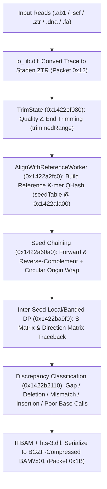

# SnapGene Alignment Architecture & Binary Format Specification

## 1. Executive Summary

SnapGene implements sequence alignment across **five specialized subsystems** rather than a single monolithic aligner. Depending on the biological task—aligning Sanger chromatograms or reads to a reference plasmid, searching for homologous sequence features, performing pairwise global/local/semi-global alignment, running multiple sequence alignments (MSA), or assembling de novo contigs—SnapGene dispatches work across:

1. **In-Process Native C++ Reference Alignment Engine** (`AlignWithReferenceManager`, `AlignWithReferenceWorker`, `TrimState`) backed by `io_lib.dll` (Staden chromatogram I/O) and `hts-3.dll` (`BAM\x01` serialization).
2. **In-Process SIMD Semi-Global Alignment Engine** (`SimilarNucleicAcidSearcher`, `AlignerThreadMapper`) dynamically bound to `Tools/parasail/parasail.dll` (strictly version-locked to `2.6.1`).
3. **Out-of-Process Pairwise Alignment Engine** (`PairwiseAligner`, `ParasailGlobal`, `ParasailLocal`, `ParasailSemiGlobal`) invoking `Tools/parasail/parasail_aligner.exe` with an Enhanced Suffix Array (SA + LCP + BWT) exact-match filter.
4. **Out-of-Process Multiple Sequence Alignment (MSA) Engine** (`MultipleSequenceAligner` subclasses: `MUSCLE`, `MAFFT`, `ClustalOmega`, `TCoffee`) combined with in-process frequency, consensus, sequence logo (`AlignmentLogosEngine`), and Valdar (2001) PET91 conservation scoring (`AlignmentViewDataModel`).
5. **Hybrid Contig Assembly Pipeline** (`CAP3`, `CircularContigBuilder`) orchestrating `Tools/cap3/cap3.exe`, `Tools/samtools/ace2sam.exe`, and `Tools/samtools/samtools.exe` / `hts-3.dll`.

All alignment results are persisted inside SnapGene's big-endian Type-Length-Value (TLV) container files (`.dna`, `.dnaln`, `.praln`) using dedicated packet types (`0x10`, `0x11`, `0x12`, `0x18`, `0x19`, and `0x1B`).

---

## 2. Subsystem Overview Matrix

| Subsystem | UI Feature / File Type | Execution Model | Core C++ Classes & VTables (`SnapGene.exe` Image Base `0x140000000`) | Underlying Engine / External Binary |
| :--- | :--- | :--- | :--- | :--- |
| **1. Reference DNA Alignment** | `Align to Reference DNA Sequence` (`.dna`) | **In-Process C++** (Multi-threaded Worker) | `AlignWithReferenceManager` (`0x1431f6b08`)<br>`AlignWithReferenceWorker` (`0x1431f6de0`)<br>`AlignableSequences` (`0x143218038`)<br>`TrimState` (`0x1431fa238`)<br>`TrimmingOptions` (`0x143151350`) | Native **K-mer Seed Hash (`QHash`) + Seed Chaining + Local/Banded DP (`S matrix` / `Direction matrix`)** + `io_lib.dll` (ZTR) + `hts-3.dll` (BAM) |
| **2. Homology & Feature Search** | Automatic Feature Detection / Similar Sequence Search | **In-Process SIMD DLL** (`LoadLibrary` Dynamic Binding) | `SimilarNucleicAcidSearcher` (`0x143205d78`)<br>`AlignerThreadMapper` (`0x14238aa80`) | `Tools/parasail/parasail.dll` **v2.6.1** (`parasail_sg_stats`, `parasail_sg_trace`) |
| **3. Pairwise Sequence Alignment** | `Align Two Sequences` | **Subprocess CLI** (`QProcess`) | `PairwiseAligner`<br>`Parasail` (`0x1431abe58`)<br>`ParasailGlobal` (`0x1431ac048`)<br>`ParasailLocal` (`0x1431ac170`)<br>`ParasailSemiGlobal` (`0x1431ac6f8`) | `Tools/parasail/parasail_aligner.exe` (`nw_trace`, `sw_trace`, `sg_trace`, `nw_banded` + Suffix Array filter) |
| **4. Multiple Sequence Alignment (MSA)** | `Align Multiple Sequences` (`.dnaln`, `.praln`) | **Subprocess CLI** (`QProcess` + Regex Progress Parser) | `MultipleSequenceAligner`<br>`MUSCLE` (`0x14310ba00`)<br>`MAFFT` (`0x14310b940`)<br>`ClustalOmega` (`0x14310bb80`)<br>`TCoffee` (`0x14310bac0`)<br>`AlignmentViewDataModel` (`0x14317c620`)<br>`AlignmentLogosEngine` (`0x1431969d8`) | `Tools/muscle/muscle.exe` (v3.8.1551)<br>`Tools/mafft/disttbfast.exe` + `f2cl.exe` (v7.471)<br>`Tools/clustalOmega/clustalo.exe` (v1.2.4)<br>`Tools/tcoffee/t_coffee.exe` (v11.00) |
| **5. Contig Assembly** | `Assemble Contigs` (`.dna`) | **Subprocess Pipeline + In-Process Circularization** | `CAP3` (`0x143134540`)<br>`CircularContigBuilder` (`0x1431346c0`) | `Tools/cap3/cap3.exe` → `Tools/samtools/ace2sam.exe` → `Tools/samtools/samtools.exe` / `hts-3.dll` |

---

## 3. Subsystem 1: In-Process Reference DNA Alignment (`AlignWithReferenceManager`)

When aligning Sanger sequencing chromatograms (`.ab1`, `.scf`, `.ztr`) or raw DNA sequences against a reference sequence, SnapGene executes an internal C++ pipeline (`0x1422a0eb0..0x1422be650`).



### 3.1 Key C++ Classes and Virtual Tables

| Class Name | VTable RVA | Primary Code Region | Role |
| :--- | :--- | :--- | :--- |
| `AlignWithReferenceManager` | `0x1431f6b08` | `0x1422a0eb0..0x1422be650` | Coordinates worker threads, manages reference alignment state, handles circular boundary adjustments |
| `AlignWithReferenceWorker` | `0x1431f6de0` | `0x1422a2fc0..0x1422bb791` | Executes k-mer seeding, seed chaining, local/banded DP gap filling, and discrepancy classification |
| `AlignableSequences` | `0x143218038` | `0x142485905..0x14248e8e6` | Parses and serializes Packet `0x11` (`<AlignableSequences>`) metadata |
| `TrimState` | `0x1431fa238` | `0x1422ef080..0x1422f077a` | Implements 5'/3' trace quality and ambiguity trimming (`TRIM_STRINGENCY`) |
| `TrimmingOptions` | `0x143151350` | `0x1422f0780..0x1422f0b00` | Stores stringency thresholds (`Light`, `Medium`, `Strict`, `Custom`) |
| `RealignToReferenceDialog` | `0x1431d98c0` | `0x14208bfbd` | Controls strand options (e.g., `"Do not align reverse complemented sequences"`) |
| `AlignWithReferenceSettingsDialog` | `0x1431f70a8` | `0x1422be650` | Configures seed, gap, and trimming parameters |

### 3.2 Step 1: Chromatogram Ingestion & ZTR Conversion (`io_lib.dll`)
SnapGene links against Staden `io_lib.dll` and imports:
- `read_reading`, `write_reading`, `deallocate_reading`, `read_alloc`
- `mfcreate`, `mfreopen`, `mfdestroy`, `mfwrite`
- `ztr_read`, `srf_read`

When an ABI (`.ab1`) or SCF (`.scf`) trace is imported for alignment, SnapGene converts the chromatogram in memory via `mfcreate` / `write_reading` into a **Staden ZTR v1.2** binary stream (`\xaeZTR\r\n\x1a\n\x01\x02`) containing `SMP4` (4-channel trace samples), `BASE` (called nucleotides), `BPOS` (peak positions), `CNF4` (confidence/Phred quality values), `TEXT`, and `CLIP` chunks. This ZTR payload is stored inside inner **Packet `0x12`** of **Packet `0x10`**.

### 3.3 Step 2: Quality and End Trimming (`TrimState`, `0x1422ef080..0x1422f077a` & `0x1422fb710..0x1422fc4df`)
Before alignment, `TrimState` (`vtable @ 0x1431fa238`) computes the usable sub-range of each chromatogram trace or sequence using a **25-bp sliding-window anchored Modified Mott (maximum-subarray) algorithm** (`0x1422fb710..0x1422fbd88`):

1. **Per-Base Error Probability Conversion (`0x1422fbf35..0x1422fbf49`)**:
   Each base's Phred quality score $Q_i$ is converted to its base-calling error probability:
   $$P_{\text{error}}(i) = 10^{-0.1 \times Q_i}$$

2. **Stringency Levels & Exact Phred Quality Thresholds (`0x1422fc270..0x1422fc4df`)**:
   `TrimState::TRIM_STRINGENCY` defines 9 enum states (`0..8`, string tables at `0x1431fa5f0..0x1431fa6c8`; legacy 3-tier UI aliases `Light` / `Medium` / `Strict` map to `Low` / `Medium` / `High`, or `Lower` / `Medium` / `Higher`). Each stringency level specifies an **Error Probability Limit $P_{\text{limit}}$**, assigning each base $i$ a net score:
   $$\text{score}[i] = P_{\text{limit}} - P_{\text{error}}(i) = P_{\text{limit}} - 10^{-0.1 \times Q_i}$$
   A base contributes positively ($\text{score}[i] > 0$) if and only if $Q_i > Q_{\text{threshold}} = -10 \log_{10}(P_{\text{limit}})$:

| Enum ID | XML / Internal Name | UI Label (`0x1431fa600`) | $P_{\text{limit}}$ (`double` VA) | Exact $Q_{\text{threshold}} = -10\log_{10}(P_{\text{limit}})$ | Integer Phred $Q$ for Positive Score ($\text{score}[i] > 0$) | Base Call Accuracy |
| :---: | :--- | :--- | :--- | :---: | :---: | :---: |
| `0` | (None) | No Trimming | `0.0` (`xorps`) | — | — | — |
| `1` | `Custom` | Custom end trimming | `0.1` (`0x143062e20`) | **$10.00$** | $Q \ge 11$ ($Q = 10 \implies 0.0$) | $90.0\%$ |
| `2` | `Lowest` | Lowest Stringency | `0.4` (`0x143097768`) | **$3.98$** | **$Q \ge 4$** | $60.0\%$ |
| `3` | `Lower` | Lower Stringency | `0.3` (`0x1430d0080`) | **$5.23$** | **$Q \ge 6$** | $70.0\%$ |
| `4` | `Low` (`Light`) | Low Stringency | `0.2` (`0x143062e28`) | **$6.99$** | **$Q \ge 7$** | $80.0\%$ |
| `5` | `Medium` | Medium Stringency (Default) | `0.1` (`0x143062e20`) | **$10.00$** | **$Q \ge 11$** ($Q = 10 \implies 0.0$) | $90.0\%$ |
| `6` | `High` (`Strict`) | High Stringency | `0.05` (`0x143062e18`) | **$13.01$** | **$Q \ge 14$** | $95.0\%$ |
| `7` | `Higher` | Higher Stringency | `0.01` (`0x1430775e8`) | **$20.00$** | **$Q \ge 21$** ($Q = 20 \implies 0.0$) | $99.0\%$ |
| `8` | `Highest` | Highest Stringency | `0.001` (`0x143098748`) | **$30.00$** | **$Q \ge 31$** ($Q = 30 \implies 0.0$) | $99.9\%$ |

3. **25-bp Sliding-Window Anchor & Bidirectional Maximum-Subarray Extension (`0x1422fb710..0x1422fbd88`)**:
   - **Window Size**: $W = \min(N, 25)\text{ bp}$ (`mov eax, 0x19` at `0x1422fb92b`).
   - **Chromatogram Trace Search Limit**: If the input is a chromatogram trace, the initial anchor window search is restricted to the first **`800 bp`** (`mov eax, 0x320` at `0x1422fb9cc`): $L_{\text{search}} = \min(N, 800)$.
   - **Anchor Selection (`0x1422fba00..0x1422fbb20`)**: Slides the $W$-bp window across $[0, L_{\text{search}} - 1]$ to find the window starting at $w^*$ with the maximum sum of $\text{score}[i]$, and sets the midpoint anchor:
     $$\text{anchor} = w^* + \lfloor W / 2 \rfloor$$
   - **Left & Right Extension (`0x1422fbb24..0x1422fbcc5`)**:
     - Walks left from $i = \text{anchor} - 1$ down to $0$ to find `trim_start` that maximizes the cumulative sum $\sum_{i=\text{trim\_start}}^{\text{anchor}} \text{score}[i]$.
     - Walks right from $i = \text{anchor} + 1$ up to $N - 1$ to find `trim_end` that maximizes the total cumulative sum $\sum_{i=\text{trim\_start}}^{\text{trim\_end}} \text{score}[i]$.
   - If the maximum total score $> 0.0$ (`0x1422fbcd6`), the kept range is `[trim_start, trim_end]` (stored as 1-based inclusive `trimmedRange="start..end"` in Packet `0x11`); otherwise, the entire read is trimmed out.
   - In addition, `0x1422ef080..0x1422effd3` performs base-call quality and homopolymer/ambiguity checks over canonical bases `ACGT` (`0x1422ef1b9`), gap characters `-` (`0x2d` at `0x1422ef29d`), and ambiguous `N` bases (`0x4e` at `0x1422ef2cc`).

### 3.4 Step 3: Adaptive K-mer Seed Length, Step Size, and Indexing (`0x1422a8f90..0x1422a9041` & `0x1422afb50..0x1422b0118`)

#### 1. Small-Sequence Direct DP Bypass (`0x1422a7580..0x1422a7613`)
Before building a k-mer index, SnapGene checks the product of the query length $L_{\text{test}}$ and reference length $L_{\text{ref}}$:
$$L_{\text{test}} \times L_{\text{ref}} \le 10{,}000.0 \quad (\text{double @ } \mathtt{0x1430d0248})$$
If $L_{\text{test}} \times L_{\text{ref}} \le 10{,}000$ and no sub-range restriction is active, SnapGene bypasses k-mer seeding entirely and directly runs dynamic programming (`0x1422bce40`).

#### 2. Adaptive K-mer Seed Length Formula (`calcSeedLength`, `0x1422a8f90..0x1422a900a`)
Function `0x1422a8f90` computes the exact seed length $k \in [1, 50]$ from `test_len` ($L_{\text{test}}$, `ecx`) and `ref_len` ($L_{\text{ref}}$, `edx`) in three stages:

1. **Base Seed Length $k_{\text{base}}$ from Reference Length $L_{\text{ref}}$ (`0x1422a8f90..0x1422a8fc4`)**:
   $$k_{\text{base}}(L_{\text{ref}}) = \begin{cases} 10 & \text{if } L_{\text{ref}} \le 35{,}000\text{ bp } (\mathtt{0x88b8}) \quad \text{(standard plasmids)} \\ 12 & \text{if } 35{,}000 < L_{\text{ref}} \le 500{,}000\text{ bp } (\mathtt{0x7a120}) \quad \text{(BACs / cosmids / viral genomes)} \\ 18 & \text{if } 500{,}000 < L_{\text{ref}} \le 2{,}000{,}000{,}000\text{ bp } (\mathtt{0x77359400}) \quad \text{(bacterial / eukaryotic chromosomes)} \\ 24 & \text{if } L_{\text{ref}} > 2{,}000{,}000{,}000\text{ bp} \end{cases}$$

2. **Short-Query Clamping from Query Length $L_{\text{test}}$ (`0x1422a8fc6..0x1422a8fdf`)**:
   $$k_{\text{clamped}} = \begin{cases} \min(k_{\text{base}},\, L_{\text{test}}) & \text{if } L_{\text{test}} < 36\text{ bp } (\mathtt{0x24}) \\ \min(k_{\text{base}},\, 18) & \text{if } 36 \le L_{\text{test}} < 48\text{ bp } (\mathtt{0x30}) \\ k_{\text{base}} & \text{if } L_{\text{test}} \ge 48\text{ bp} \end{cases}$$

3. **Proportional $0.5\%$ Scaling and Hard Cap at $50\text{ bp}$ (`0x1422a8fe1..0x1422a900a`)**:
   Using the `double` constant `0.005` (`1 / 200`) at `0x1431f7018`:
   $$k = \min\!\Big(50,\; \max\!\big(k_{\text{clamped}},\; \lfloor 0.005 \times \min(L_{\text{test}}, L_{\text{ref}}) \rfloor\big)\Big)$$
   - For a typical Sanger sequencing read ($L_{\text{test}} \approx 800\text{ bp}$) aligned against a plasmid ($L_{\text{ref}} \approx 5{,}000\text{ bp}$), $\lfloor 0.005 \times 800 \rfloor = 4 < 10$, yielding **`k = 10` bp**.
   - When both query and reference are large (e.g., $\min(L_{\text{test}}, L_{\text{ref}}) \ge 10{,}000\text{ bp}$), $k$ scales up to the hard ceiling of **`50` bp** (`0x32`).

#### 3. Query Seed Step Size & Mismatch Allowance (`0x1422a615a..0x1422a61b3` & `0x1422a9010..0x1422a9041`)
- **Initial Query Step Size (`0x1422a615a..0x1422a61b3`)**:
  $$\text{step} = \begin{cases} 1\text{ bp} & \text{if } L_{\text{test}} < 24\text{ bp } (\mathtt{0x18}) \\ \lfloor k / 2 \rfloor\text{ bp} & \text{if } L_{\text{test}} \ge 24\text{ bp} \quad (\text{e.g., } \text{step} = 5\text{ bp when } k = 10) \end{cases}$$
- **Adaptive Step Acceleration on Unmatched Regions (`0x1422abe06..0x1422abec8`)**:
  During seed scanning (`0x1422abc60`), if $\text{step} > 1$, no seeds have been found yet, and **`20` consecutive steps** (`0x14`) yield zero hits while the remaining query length $L_{\text{rem}} > 20 \times \text{step}$, the step size is dynamically increased to $\lfloor L_{\text{rem}} / 20 \rfloor$.
- **Seed Mismatch Allowance (`0x1422a9010..0x1422a9041`)**:
  $$\text{max\_mismatches} = \begin{cases} 0 & \text{if } L_{\text{test}} \le 12\text{ bp} \\ 1 & \text{if } L_{\text{test}} > 12 \text{ and } k \le 8 \\ 2 & \text{if } L_{\text{test}} > 12 \text{ and } 9 \le k \le 10 \\ \min(\lfloor k / 3 \rfloor,\, 8) & \text{if } L_{\text{test}} > 12 \text{ and } k > 10 \end{cases}$$
- **Reference K-mer Hash Table (`0x1422afb50..0x1422b0118`)**:
  `AlignWithReferenceWorker::run` (`0x1422a2fc0`) builds an in-memory Qt `QHash` k-mer index (`seedTable` helper at `0x1422afa00`), normalizing RNA `U` to DNA `T` (`0x1422ac984..0x1422ac9b3`) and rejecting all-`N` windows (`0x1408e8140`). Each seed hit is bidirectionally extended without gaps as far as exact base matches continue (`0x142287f6a..0x142288146`), and leading/trailing `N` bases are stripped (`0x14228814c..0x1422883ae`).

### 3.5 Step 4: Seed Chaining Conditions, Maximum Gap Limits, and Recursive Sub-Seeding (`0x1422a60a0..0x1422aeff0`)

Each matched seed is stored as a 28-byte (`0x1c`) `SeedSegment` structure (`0x142288c00..0x142288eff`):
- `+0x00` (`int32`): `test_start` (0-based query start coordinate)
- `+0x04` (`int32`): `ref_start` (0-based reference start coordinate)
- `+0x08` (`int32`): `length` (extended seed length in bp)
- `+0x0c` (`int32`): `mismatches` (mismatch count within the seed)
- `+0x10` (`int32`): `test_group_id`
- `+0x14` (`int32`): `chain_order_index`
- `+0x18..0x1a` (`uint8[3]`): `is_chained`, `is_gap_or_indel`, `sub_aligned` flags

#### 1. Collinear Seed Chaining Conditions (`canChainSeed`, `0x14228d280..0x14228d526` & `0x1422a9e90`)
In `0x1422a9e90`, candidate seeds are chained into collinear alignment paths. A candidate next seed $S_{\text{next}}$ can be chained after the current chain $C = (S_0, \dots, S_{\text{prev}})$ if and only if all four conditions hold inside `0x14228d280`:
1. **Strict Query Progression (`0x14228d2fc..0x14228d308`)**:
   $S_{\text{next}}.\text{test\_start}$ must advance past $S_{\text{prev}}$ along the query sequence (when scanning for the next seed in `0x1422ac191..0x1422ac21d`, consecutive seeds may overlap by at most **`3 bp`** before trimming).
2. **Collinear Reference Order & Circular Topology Check (`0x14228d325..0x14228d434`)**:
   - On a **linear** reference (`isCircular() == false` via `0x1422e39f0`), $S_{\text{next}}.\text{ref\_end} \ge S_0.\text{ref\_start}$.
   - On both linear and **circular** references (`0x140afb120` / `0x140afa7b0`), $S_{\text{next}}$ must follow $S_{\text{prev}}$ in the forward reference direction without wrapping around $S_0$ (a single chain cannot circle the plasmid more than once).
3. **Minimum Non-Overlapping Reference Advance (`0x14228d453..0x14228d47c`)**:
   $S_{\text{next}}$ must advance the aligned reference coverage by at least **`2 bp`** beyond $S_{\text{prev}}$ (`cmp ebx, 0x2; jl 0x14228d504` at `0x14228d479`).
4. **Maximum Allowed Reference Span / Gap Limit (`0x14228d482..0x14228d500` & `0x1422ad850`)**:
   Let $\Delta L_{\text{query}} = S_{\text{next}}.\text{test\_end} - S_0.\text{test\_start} + 1$ be the query span of the chain, and $\Delta L_{\text{ref}} = (S_{\text{next}}.\text{ref\_end} - S_0.\text{ref\_start}) \bmod L_{\text{ref}} + 1$ be the reference span. Function `0x1422ad850` enforces the upper bound:
   $$\Delta L_{\text{ref}} \le \min\!\big(1000 \times \Delta L_{\text{query}},\; 5{,}000{,}000\text{ bp}\big) \quad (\mathtt{imul\ ecx, eax, 0x3e8;\ mov\ eax, 0x4c4b40})$$
   - This $1000\times$ multiplier (capped at **`5,000,000 bp`** / $5\text{ Mb}$) allows the same seed chainer to bridge both ordinary indels in sequencing reads and large spliced introns when aligning cDNA/mRNA exons to genomic DNA.
   - The identical bound $\max\_\text{ref\_len} = \min(1000 \times L_{\text{overhang}},\, 5{,}000{,}000\text{ bp})$ is applied when extending unaligned 5' or 3' terminal overhangs (`0x1422a6fbc..0x1422a7016`).
5. **Chain Scoring & Tie-Breaking (`0x14228c9c0..0x14228ca95` & `0x14228d680..0x14228d94d`)**:
   - Chains are ranked primarily by **total exact matched bases**:
     $$\text{ChainScore} = \sum_{s \in C} (s.\text{length} - s.\text{mismatches})$$
   - Ties are broken by **fewest gaps/indels** (`[rdi+0xd4]` / `[rdi+0xd8]` computed in `0x14228d720`).

#### 2. Recursive Gap Sub-Seeding (`0x1422a6360..0x1422a6776`)
For every unaligned gap $(L_{\text{gap,test}}, L_{\text{gap,ref}})$ between two consecutive chained seeds $S_i$ and $S_{i+1}$, SnapGene computes a smaller seed length:
$$k_{\text{sub}} = \max\!\big(10,\; \text{calcSeedLength}(L_{\text{gap,test}},\, L_{\text{gap,ref}})\big)$$
If $k_{\text{sub}} < k_{\text{current}}$, $L_{\text{gap,test}} \ge k_{\text{sub}}$, and $L_{\text{gap,ref}} \ge k_{\text{sub}}$ (`0x1422a6456..0x1422a646f`), SnapGene recursively invokes `0x1422a60a0` inside the inter-seed gap to discover and chain smaller anchors before falling back to dynamic programming.

#### 3. Seed Boundary Erosion Before DP (`0x1422a6e4c..0x1422a6ee2` & `0x1422a8d90..0x1422a8f86`)
Before running dynamic programming on a gap between two chained seeds $S_{\text{left}}$ and $S_{\text{right}}$, SnapGene trims back the inner edges of both flanking seeds by up to **`10 bp`** (`mov eax, 0xa` at `0x1422a6e5a`):
$$\text{trim}_{\text{left}} = \min\!\big(\lfloor S_{\text{left}}.\text{length} / 2 \rfloor,\, 10\big), \qquad \text{trim}_{\text{right}} = \min\!\big(\lfloor S_{\text{right}}.\text{length} / 2 \rfloor,\, 10\big)$$
This 10-bp boundary erosion ensures that indels occurring near the edge of a k-mer seed are placed optimally by the affine-gap DP rather than being pinned outside the seed.

### 3.6 Step 5: Inter-Seed Affine-Gap Dynamic Programming with X-Drop Pruning (`0x1422b6d90..0x1422bb791`)

Unaligned regions between consecutive chained seeds (and unaligned 5'/3' overhangs) are aligned by the affine-gap dynamic programming engine in `0x1422b7f90..0x1422b9049` (and full-matrix variant `0x1422ba9f0`).

#### 1. Exact DP Scoring Parameters (`0x1422b817e` & `0x1422b892c..0x1422b8a58`)
All DP scores are computed in 32-bit IEEE-754 floating-point (`float`, `xmm` registers):

| Parameter | Exact Value (`float`) | Binary Location / Instruction (`SnapGene.exe`) | Notes |
| :--- | :---: | :--- | :--- |
| **Exact Base Match** (`q == r`) | **`+1.0`** | `mov eax, 0x1` (`0x1422b8935`) | Canonical base match (`A=A`, `C=C`, `G=G`, `T=T`) |
| **IUPAC Degenerate Match** | **`0.0`** | `mov eax, r13d` (`0x1422b8955`, via `0x1408e79c0`) | Compatible degenerate IUPAC codes (neither bonus nor penalty) |
| **Ambiguous Query `'N'`** (`q == 'N'`) | **`-1.0`** | `mov eax, 0xffffffff` (`0x1422b8941`) | Half the penalty of a standard mismatch |
| **Base Mismatch** (`q != r`) | **`-2.0`** | `mov eax, 0xfffffffe` (`0x1422b8965`) | Standard nucleotide substitution penalty |
| **Gap Open Penalty** ($G_{\text{open}}$) | **`-3.0`** | `float` @ `0x1430f19a8` (`0x1422b8986`, `0x1422b89b7`) | Applied when opening a new insertion or deletion |
| **Gap Extend Penalty** ($G_{\text{ext}}$) | **`-1.0`** | `float` @ `0x143088edc` (`0x1422b817e`, `0x1422b898f`, `0x1422b89c0`) | Applied per base of gap length ($L$-bp gap costs $-3.0 - 1.0 \times L$) |
| **X-Drop Pruning Threshold** ($X$) | **`40.0`** (cutoff **`41.0`**) | `float` @ `0x1431f73e4` (`40.0`) & `0x1431f73e8` (`-41.0`) | Prunes cells where $S[i,j] < S_{\max} - 41.0$ (`0x1422b8a54`) |

#### 2. Affine-Gap Recurrence Equations (`0x1422b892c..0x1422b8a22`)
For each cell $(i, j)$, SnapGene maintains three scores—the main score $S[i,j]$ (`xmm6`/`xmm7`), the horizontal gap score $E[i,j]$ (`xmm9`), and the vertical gap score $F[i,j]$ (`xmm8`):
$$\begin{aligned}
E[i, j] &= \max\!\big(S[i, j-1] - 3.0 - 1.0,\;\; E[i, j-1] - 1.0\big) = \max\!\big(S[i, j-1] - 4.0,\;\; E[i, j-1] - 1.0\big) \\
F[i, j] &= \max\!\big(S[i-1, j] - 3.0 - 1.0,\;\; F[i-1, j] - 1.0\big) = \max\!\big(S[i-1, j] - 4.0,\;\; F[i-1, j] - 1.0\big) \\
S[i, j] &= \max\!\big(S[i-1, j-1] + \text{match\_score}(q_i, r_j),\;\; E[i, j],\;\; F[i, j]\big)
\end{aligned}$$
where opening a 1-bp gap costs $G_{\text{open}} + G_{\text{ext}} = -3.0 + (-1.0) = -4.0$, and each additional gap base costs $G_{\text{ext}} = -1.0$.

#### 3. Traceback Direction Matrix Encoding (`0x1422b89d3..0x1422b8a22`)
The `Direction matrix:` (`[rsp+0x50]`) stores a 32-bit integer code per cell $(i, j)$:
- **`1`**: Diagonal transition ($S[i-1, j-1] \to S[i, j]$, Match or Mismatch)
- **`2`**: Vertical gap transition ($F[i, j]$, Deletion / gap in query)
- **`3`**: Horizontal gap transition ($E[i, j]$, Insertion / gap in reference)

#### 4. Banded X-Drop Pruning & Early Termination (`0x1422b8a54..0x1422b8f5c`)
- SnapGene tracks the running maximum score $S_{\max}$ (`xmm10`) across the DP table.
- At each cell (`0x1422b8a54`), if $S[i,j] < S_{\max} - 40.0 - 1.0 = S_{\max} - 41.0$, the cell is marked as pruned (`-1e30` / `-FLT_MAX`), dynamically narrowing the active column band `[col_start, col_end]` for the next row (`0x1422b8aa8..0x1422b8b38`).
- At the end of each row (`0x1422b8f18..0x1422b8f5c`), if the row's maximum score falls below $S_{\max} - 41.0$, the DP terminates early and traces back from the global best cell $(i^*, j^*)$.
- After traceback, `0x1422b2110..0x1422b245c` classifies every discrepancy between the aligned read and the reference sequence into `Gap`, `Deletion`, `Mismatch`, `Insertion`, `numNs=`, `matchablePoorBaseCalls=`, and `unmatchablePoorBaseCalls=`.

### 3.7 Step 6: BAM Serialization (`IFBAM` + `hts-3.dll`)
SnapGene embeds HTSlib (`hts-3.dll`) via its internal `IFBAM` wrapper (`0x1430d6ec0`), importing:
- `hts_open_format`, `hts_close`, `sam_hdr_read`, `sam_hdr_write`, `sam_hdr_destroy`
- `bam_init1`, `bam_destroy1`, `sam_read1`, `sam_write1`, `bam_cigar2qlen`, `bam_cigar2rlen`

Each aligned read is converted into a standard `BAM\x01` alignment record (where `read_name` is the decimal ASCII string of `<Sequence ID>`, e.g., `"0"`, `"1"`) and compressed with **BGZF** (`\x1f\x8b\x08\x04...BC\x02\x00`) into **Packet `0x1B`**.

---

## 4. Subsystem 2: In-Process SIMD Semi-Global Alignment (`parasail.dll` + `SimilarNucleicAcidSearcher`)

For high-throughput internal searches—such as scanning a plasmid against hundreds of feature sequences (`SimilarNucleicAcidSearcher`)—SnapGene avoids subprocess creation overhead and loads `Tools/parasail/parasail.dll` directly into its address space.

### 4.1 Dynamic DLL Loader & Strict Version Check (`0x14091f830..0x14091fb40`)
Function `0x14091f830` resolves `Tools/parasail/parasail.dll` (`0x1430b0020`) at runtime and verifies the library version via `parasail_version(&major, &minor, &patch)` (`0x14091f93e`):

```asm
0x14091f93e: call rax                          ; parasail_version(&major, &minor, &patch)
0x14091f940: cmp  dword ptr [rsp + 0x30], 2    ; major == 2
0x14091f947: jne  0x14091f95d
0x14091f949: cmp  dword ptr [rsp + 0x38], 6    ; minor == 6
0x14091f950: jne  0x14091f95d
0x14091f952: cmp  dword ptr [rsp + 0x40], 1    ; patch == 1
0x14091f959: je   0x14091f9b0                  ; proceed if and only if v2.6.1
```

If the version is not exactly **`2.6.1`**, SnapGene aborts loading and logs `Invalid parasail library version`. Upon verification, it binds 8 function pointers into the wrapper object (`rbx`):

| Struct Offset | Imported Symbol (`parasail.dll`) | Purpose |
| :--- | :--- | :--- |
| `[rbx + 0x18]` | `parasail_matrix_create` | Allocates custom scoring matrix |
| `[rbx + 0x20]` | `parasail_matrix_set_value` | Populates individual `(row, col)` substitution scores |
| `[rbx + 0x28]` | `parasail_sg_trace` | SIMD semi-global alignment with traceback |
| `[rbx + 0x30]` | `parasail_sg_stats` | Fast SIMD semi-global score/matches/length calculation (no traceback) |
| `[rbx + 0x38]` | `parasail_result_free` | Frees `parasail_result_t` |
| `[rbx + 0x40]` | `parasail_result_get_traceback` | Extracts gapped query/target strings from traceback |
| `[rbx + 0x48]` | `parasail_traceback_free` | Frees `parasail_traceback_t` |
| `[rbx + 0x50]` | `parasail_matrix_free` | Frees `parasail_matrix_t` |

### 4.2 IUPAC Ambiguity Matrix & Two-Stage Multi-Threaded Search (`0x142382f90..0x14238bc80`)
1. **IUPAC Scoring Matrix (`0x142382f90`)**:
   - Builds a custom substitution matrix over the 17-character IUPAC nucleotide alphabet `"ATGCSWRYKMBVHDNU*"` (`0x143205b78`) using `parasail_matrix_create` and `parasail_matrix_set_value`.
   - This allows degenerate bases (e.g., `R` = `A/G`, `Y` = `C/T`, `N` = any) to receive fractional/positive match scores during alignment.
2. **Two-Stage Filtering (`SimilarNucleicAcidSearcher::AlignerThreadMapper`, `0x14238aa80..0x14238bc80`)**:
   - Executed in parallel across CPU cores via `QtConcurrent::MappedReducedKernel` (`vtable @ 0x143205d78`).
   - **Stage 1 (Fast Filter)**: Calls `parasail_sg_stats` (`[rbx + 0x30]`) inside `0x142384370` to compute the semi-global alignment score and identity percentage without allocating traceback matrices.
   - **Stage 2 (Traceback)**: Only if the candidate exceeds the similarity threshold, calls `parasail_sg_trace` (`[rbx + 0x28]`) and `parasail_result_get_traceback` (`[rbx + 0x40]`) to construct the gapped alignment.

---

## 5. Subsystem 3: Pairwise Sequence Alignment (`PairwiseAligner` & `parasail_aligner.exe`)

The interactive `Align Two Sequences` feature is implemented by the `PairwiseAligner` hierarchy (`0x142101c80..0x142102bc0`), which spawns `Tools/parasail/parasail_aligner.exe` (`SHA-256: 7c128b42c2281a743e4b0182f6e023b209c0cabfdcedcd55189c41a2e4cfc345`).

### 5.1 C++ Class Hierarchy (`SnapGene.exe`)
- `PairwiseAligner` (abstract base)
  - `Parasail` (`vtable @ 0x1431abe58`)
    - `ParasailGlobal` (`vtable @ 0x1431ac048`): Global alignment (Needleman-Wunsch, `-a nw_trace`)
    - `ParasailLocal` (`vtable @ 0x1431ac170`): Local alignment (Smith-Waterman, `-a sw_trace`)
    - `ParasailSemiGlobal` (`vtable @ 0x1431ac6f8`): Semi-global alignment (free end-gaps, `-a sg_trace`)

### 5.2 `parasail_aligner.exe` Architecture (`0x14000d190`)
In `parasail_aligner.exe`, `main` (`0x14000d190`) parses command-line options using `getopt` with format string `"a:A:b:c:Cde:Ef:g:Ghi:k:l:m:M:o:O:pq:r:s:t:vVxX:"` (help output in `0x14000bc00`):

| CLI Option | Default | Description |
| :--- | :--- | :--- |
| `-a <funcname>` | `nw_stats_striped_16` | Parasail alignment function (`nw_trace`, `sw_trace`, `sg_trace`, `nw_banded`) |
| `-c <cutoff>` | `7` | Exact match seed length cutoff for the Suffix Array filter |
| `-x` | `false` | Disable the Suffix Array filter (`!use_filter`) and align all pairs directly |
| `-d` | `false` | Use DNA alphabet (`ACGT`) with `-M <match>` and `-X <mismatch>` |
| `-M <match>` | `1` | DNA match score (when `-d` is active) |
| `-X <mismatch>` | `0` | DNA mismatch penalty (when `-d` is active) |
| `-m <matrix>` | `blosum62` | Scoring matrix name or path from `Matrices/` (`dnafull`, `nuc44`, `blosum30..100`, `blosumn`, `pam10..500`) |
| `-o <gap_open>` | `10` | Gap open penalty |
| `-e <gap_extend>` | `1` | Gap extension penalty |
| `-k <band>` | `3` | Band width `k` when `-a nw_banded` is selected |
| `-f <file>` | (Required) | Target/database FASTA/FASTQ file |
| `-q <file>` | (Optional) | Query FASTA/FASTQ file |
| `-g <file>` | `parasail.csv` | Output file path |
| `-O <format>` | (CSV stats) | Traceback output format: `EMBOSS`, `SAM`, `SAMH`, or `SSW` |
| `-t <threads>` | OpenMP max | Number of OpenMP worker threads |
| `-A <alphabet>` | `ACGT` | Ambiguous base replacement characters |

### 5.3 Enhanced Suffix Array (SA + LCP + BWT) Pre-Filter (`0x140016c20`)
Unless `-x` is passed, `parasail_aligner.exe` constructs an **Enhanced Suffix Array** (`sais` induced sorting + Longest Common Prefix `LCP` array + Burrows-Wheeler Transform `BWT` at `0x140016c20`) over the concatenated sequences. Only sequence pairs sharing at least one exact match of length $\ge c$ (`cutoff`, default `7`) are dispatched to the SIMD alignment kernel (`parasail_lookup_function` / `parasail_nw_banded`).

---

## 6. Subsystem 4: Multiple Sequence Alignment (`MultipleSequenceAligner`)

Multiple Sequence Alignment (`Align Multiple Sequences`, producing `.dnaln` for DNA or `.praln` for protein) is implemented via four concrete subclasses of `MultipleSequenceAligner`. Each subclass writes temporary input files, launches an external binary in `Tools/`, parses `stdout`/`stderr` using `QRegularExpression` to drive the UI progress bar, and reads back the aligned output.

### 6.1 External Aligner Implementations

#### 1. `MUSCLE` (`vtable @ 0x14310ba00`, `0x1420cc220..0x1420cd350`)
- **Executable**: `Tools/muscle/muscle.exe` (MUSCLE v3.8.1551)
- **CLI Arguments**:
  - `-in1 <input.fa>`, `-out <output.aln>`, `-clw` (ClustalW output), `-maxiters <n>`, `-maxhours <h>`, `-seqtype <dna|protein|auto>`, `-gapopen <penalty>`
  - Clustering (`-cluster1`, `-cluster2`): `upgma`, `upgmb`, `neighborjoining`
  - Distance metrics (`-distance1`): `kmer6_6`, `kmer20_3`, `kmer20_4`, `kbit20_3`, `kmer4_6`
  - Stage 2 distance (`-distance2`): `pctidkimura`, `pctidlog`
  - Objective score (`-objscore`): `sp`, `spf`, `spm`, `dp`, `ps`, `xp`
  - Sequence weighting (`-weight1`, `-weight2`): `none`, `henikoff`, `henikoffpb`, `gsc`, `clustalw`, `threeway`
  - Diagonals: `-diags`, `-diags1`, `-diags2`
- **Progress Regex (`0x1431a8060`)**:
  ```regex
  Iter\s+(\d+)\s+(\d+.\d\d)%
  ```

#### 2. `MAFFT` (`vtable @ 0x14310b940`, `0x14208e6f0..0x142090d20`)
- **Executables**: `Tools/mafft/disttbfast.exe` and `Tools/mafft/f2cl.exe` (MAFFT v7.471)
- **Default Strategy & Parameters**:
  - Strategy: `FFT-NS-2`
  - Gap open penalty (`-f`): `-1.53`
  - Offset / penalty shift (`-g`): `100.0`
  - K-tuple size (`-W`): `6` (protein) or `10` (DNA)
  - Output conversion via `f2cl.exe` (`-f` format, `-n` name width, `-o` output)
- **Progress Regexes (`0x1431a5438..0x1431a5460`)**:
  ```regex
  Progressive alignment (\d+)/(\d+)
  STEP\s+(\d+) / (\d+)
  ```

#### 3. `ClustalOmega` (`vtable @ 0x14310bb80`, `0x142067bf0..0x142068c20`)
- **Executable**: `Tools/clustalOmega/clustalo.exe` (Clustal Omega v1.2.4)
- **CLI Arguments**:
  - `--in`, `--out`, `--outfmt`, `--seqtype`, `--cluster-size`, `--clustering-out`
  - `--full`, `--full-iter`, `--iterations`, `--max-guidetree-iterations`, `--max-hmm-iterations`, `--use-kimura`, `--percent-id`, `--verbose`
- **Progress Regexes (`0x1431a3008..0x1431a3070`)**:
  ```regex
  Ktuple-distance calculation progress: (\d+) %
  Distance calculation within sub-clusters: (\d+) %
  Progressive alignment progress: (\d+) %
  ```

#### 4. `TCoffee` (`vtable @ 0x14310bac0`, `0x142040344..0x1420414e0`)
- **Executable**: `Tools/tcoffee/t_coffee.exe` (T-Coffee v11.00.8cbe486)
- **CLI Arguments**:
  - `-seq`, `-outfile`, `-output` (`clustalw_aln`, `fasta_aln`, `msf_aln`, `phylip_aln`, `score_html`, `score_ascii`)
  - `-mode` (`expresso`, `mcoffee`, `rcoffee`, `evaluate`, `accurate`, `procoffee`)
  - `-multi_core`, `-n_core`, `-distance_matrix_mode`, `-profile_comparison`, `-dp_mode`, `-clean_aln`, `-iterate`
- **Progress Regex (`0x1431a1680`)**:
  ```regex
  \[Submit\s+Job\]\[TOT=\s*\d+\]\[\s{0,2}(\d+)\s%\]\[
  ```

### 6.2 Consensus, Sequence Logos, and Conservation Scoring
Once the aligned sequences are loaded into `AlignmentViewDataModel` (`vtable @ 0x14317c620`):
- **Column Frequencies & Consensus**:
  - `initFrequencies` tallies per-column nucleotide or amino acid counts.
  - `initConsensusSource` generates the consensus row using the configured `consensusThreshold`.
- **Sequence Logos (`AlignmentLogosEngine`, `vtable @ 0x1431969d8`)**:
  - Calculates information content (in bits) and residue stack heights per column, filtered by `logoThreshold`.
- **Protein Conservation Scoring (`0x141fba98a` & `0x141fc8abe`)**:
  - For protein alignments (`.praln`), SnapGene computes column conservation scores using **Valdar's (2001) method** backed by the **PET91 substitution matrix** loaded from `Matrices/valdar2001_pet91.txt`.

---

## 7. Subsystem 5: Contig Assembly (`CAP3` + `CircularContigBuilder` + `ace2sam` + `samtools`)

The `Assemble Contigs` workflow (`0x1416deb20..0x1416e54c4`) combines overlap-layout-consensus assembly with circular plasmid detection and BAM conversion:


1. **CAP3 Execution (`CAP3`, `vtable @ 0x143134540`, `0x1416e3910..0x1416e4400`)**:
   - Writes input sequences to `input.fa` and quality scores to `input.fa.qual`.
   - Executes `Tools/cap3/cap3.exe`, producing `%1.cap.ace`, `%1.cap.contigs`, `%1.cap.contigs.links`, `%1.cap.contigs.qual`, `%1.cap.info`, and `%1.cap.singlets`.
2. **Circular Contig Detection (`CircularContigBuilder`, `vtable @ 0x1431346c0`, `0x1416deb80..0x1416df600`)**:
   - Evaluates terminal self-overlap on assembled contigs (`"Is the assembled sequence circular?"` at `0x1416def51`) and merges overlapping ends into a circular `.dna` topology.
3. **ACE to SAM Conversion (`0x1416e450b` → `finishConvertingAceToSam` at `0x1416e470e`)**:
   - Invokes `Tools/samtools/ace2sam.exe` on `%1.cap.ace` to generate a SAM alignment of all constituent reads against the assembled consensus contig.
4. **SAM to BAM Packaging (`0x1416e4881..0x1416e48f4`)**:
   - Invokes `Tools/samtools/samtools.exe view` (or `hts-3.dll` via `IFBAM`) to compress the SAM alignment into **Packet `0x1B` (`BAM\x01`)** inside the resulting `.dna` document.

---

## 8. Binary Container Packet Specification for Alignments

All SnapGene files (`.dna`, `.prot`, `.dnaln`, `.praln`) use the same outer framing:
```text
[1-byte Packet Type][4-byte Big-Endian Payload Length][Payload Bytes...]
```

### 8.1 Reference Alignment & Contig Assembly Packets (inside `.dna`)

When reads or trace files are aligned to a reference `.dna` file (`Packet 0x09` `sequenceType = 1`), three alignment-specific top-level packet types are written:

#### Packet `0x10` (`dec 16`): Embedded Aligned Read / Trace Container
- **Header**: `uint32_be sequenceID` (4 bytes) matching the `ID` attribute in Packet `0x11` and the `read_name` in Packet `0x1B`.
- **Body**: An inner SnapGene TLV packet stream representing the read:
  - Standard sequences contain inner Packet `0x00` (DNA sequence + flags) and Packet `0x06` (`<Notes>`).
  - Sanger chromatogram traces contain **Inner Packet `0x12` (`dec 18`)**, whose payload is a raw **Staden ZTR v1.2** binary file:
    ```text
    Offset  Bytes                                             Description
    0x00    AE 5A 54 52 0D 0A 1A 0A 01 02                     ZTR Magic + v1.2 Header
    0x0A    53 4D 50 34 ...                                   SMP4 (4-channel trace samples)
    ...     42 41 53 45 ...                                   BASE (Called nucleotide characters)
    ...     42 50 4F 53 ...                                   BPOS (Chromatogram peak positions)
    ...     43 4E 46 34 ...                                   CNF4 (Phred confidence values)
    ...     54 45 58 54 ...                                   TEXT (Trace comments/machine metadata)
    ```

#### Packet `0x11` (`dec 17`): `<AlignableSequences>` XML Metadata
UTF-8 XML document listing every aligned read, its display sort order, trace flag, and trimming state:
```xml
<?xml version="1.0"?>
<AlignableSequences trimStringency="Custom">
  <Sequence name="T7-9464-1.scf" ID="0" isTrace="1" sortOrder="0" manuallyTrimmed="1" trimmedRange="2..989"/>
  <Sequence name="SP6-9464-2.scf" ID="1" isTrace="1" sortOrder="1" manuallyTrimmed="1" trimmedRange="9..1005"/>
</AlignableSequences>
```

#### Packet `0x1B` (`dec 27`): BGZF-Compressed `BAM\x01` Alignment Stream
A standard **BGZF** (Blocked GNU Zip Format, RFC 1952 with `BC` subfield) stream that decompresses to a standard **`BAM\x01`** binary alignment file:
- **BAM Header**:
  - `magic`: `"BAM\x01"` (4 bytes)
  - `l_text`: `uint32_le` length of plain-text SAM header (`@HD\tVN:1.3\n@SQ\tSN:ref\tLN:<ref_len>\n`)
  - `n_ref`: `uint32_le` (`1`)
  - `ref_name`: `"ref\0"`, `l_ref`: `uint32_le` reference sequence length in bp
- **BAM Alignment Records** (one per aligned segment):
  - `refID`: `int32_le` (`0`)
  - `pos`: `int32_le` (0-based start coordinate on the reference sequence)
  - `l_read_name`: `uint8`, `mapq`: `uint8` (`255`), `bin`: `uint16_le`
  - `n_cigar_op`: `uint16_le`, `flag`: `uint16_le` (`0x00` = forward strand, `0x10` = reverse-complement strand)
  - `l_seq`: `int32_le` (length of aligned read segment)
  - `read_name`: Null-terminated ASCII decimal string of the read's `ID` (e.g., `"0\0"`, `"1\0"`)
  - `cigar`: Array of `uint32_le` where `op_len = val >> 4` and `op_code = val & 0xF` (`0=M, 1=I, 2=D, 3=N, 4=S, 5=H, 6=P, 7==, 8=X`)
  - `seq`: 4-bit nibble-encoded sequence (`(l_seq + 1) // 2` bytes, lookup table `"=ACMGRSVTWYHKDBN"`)
  - `qual`: `l_seq` bytes of Phred quality scores (`0xFF` if unavailable)

---

### 8.2 Multiple Sequence Alignment Packets (`.dnaln` and `.praln`)

Multiple sequence alignment files use the same TLV packet framing with distinct cookie types and two MSA-specific packets (`0x18` and `0x19`):

#### Packet `0x09`: Cookie Packet
- Payload: `"SnapGene"` (8 bytes) + `uint16_be sequenceType` + `uint16_be exportVersion` + `uint16_be importVersion`
- `sequenceType = 3`: DNA Multiple Sequence Alignment (`.dnaln`)
- `sequenceType = 4`: Protein Multiple Sequence Alignment (`.praln`)

#### Packet `0x18` (`dec 24`): MSA Project & Aligner Metadata JSON (`0x1420e33ab..0x1420e55ca`)
A UTF-8 JSON document describing the alignment methods, parameters, active sequences, and alignment slot indices:
```json
{
  "aligners": [
    {
      "name": "MUSCLE",
      "options": {
        "-clw": "true"
      }
    }
  ],
  "alignments": [
    {
      "name": "MUSCLE",
      "rawAlignment": 0,
      "editedAlignment": 1
    }
  ],
  "created": "2020-07-08T18:52:47",
  "lastModified": "2020-07-08T19:05:11",
  "profiles": [],
  "seqType": "dna",
  "sequenceIDs": [0, 1, 2, 3, 4],
  "sequences": [
    {
      "ID": 0,
      "created": "2020-07-08T18:52:47",
      "lastModified": "2020-07-08T18:52:47",
      "name": "AcGFP1",
      "use": true
    }
  ],
  "uuid": "79ba2658-b7fb-4cf6-81a0-72189957a29b",
  "version": "1"
}
```

#### Packet `0x10` (`dec 16`): Unaligned Original Input Sequences
Each input sequence is stored in its own top-level Packet `0x10`:
- **Header**: `uint32_be sequenceID` (4 bytes) matching `sequences[i].ID` in Packet `0x18`.
- **Body**: Embedded `.dna` or `.prot` packet stream containing the **ungapped** original sequence:
  - Packet `0x00` (ungapped DNA sequence) or Packet `0x15` (`dec 21`, ungapped Protein sequence)
  - Packet `0x16` (`dec 22`, `<SequenceNumbering>` XML)
  - Packet `0x06` (`<Notes>` XML)
  - Packet `0x0A` (`<Features>` XML)

#### Packet `0x19` (`dec 25`): Gapped Alignment Matrix Block
Stores the aligned (gapped) sequences for a specific alignment index (`rawAlignment` or `editedAlignment` referenced in Packet `0x18`):
- **Header**: `uint32_be alignmentIndex` (4 bytes, e.g., `0` for `rawAlignment`).
- **Body**: A contiguous sequence of **inner Packet `0x10`** blocks (one per aligned sequence):
  - Each inner Packet `0x10` begins with `uint32_be sequenceID` (4 bytes), followed by:
    - **Inner Packet `0x00`** (for `.dnaln`) or **Inner Packet `0x15`** (for `.praln`): `[1-byte flags][ASCII sequence containing '-' gap characters]` (all sequences in the block have identical gapped length).
    - **Inner Packet `0x16`**: `<SequenceNumbering>` XML defining display numbering offsets.

---

## 9. Complete Packet ID Reference Table

| Packet ID (Hex / Dec) | Container Scope | Payload Format | Description |
| :--- | :--- | :--- | :--- |
| `0x00` (0) | `.dna`, inner `0x10`/`0x19` | `1-byte flags` + ASCII | DNA sequence (ungapped in `.dna`/outer `0x10`; gapped with `-` inside `0x19`) |
| `0x05` (5) | `.dna`, inner `0x10` | UTF-8 XML | `<Primers>` definitions and hybridizations |
| `0x06` (6) | `.dna`, `.prot`, inner `0x10` | UTF-8 XML | `<Notes>` document metadata and comments |
| `0x07` (7) | `.dna` | LZMA-compressed | Embedded history tree and ancestral sequence states |
| `0x08` (8) | `.dna`, `.prot` | UTF-8 XML | `<AdditionalSequenceProperties>` (sticky ends, overhangs) |
| `0x09` (9) | All files (First Packet) | Binary (`14 bytes`) | `"SnapGene"` cookie + `sequenceType` (`1`=DNA, `2`=Protein, `3`=`.dnaln`, `4`=`.praln`) + export/import versions |
| `0x0A` (10) | `.dna`, `.prot`, inner `0x10` | UTF-8 XML | `<Features>` annotations and segments |
| `0x0D` (13) | `.dna` | UTF-8 XML | `<Enzymes>` custom restriction enzyme set |
| `0x10` (16) | `.dna`, `.dnaln`, `.praln` | `uint32_be ID` + Inner TLV | Embedded sequence or trace container (used both at top-level and inside `0x19`) |
| `0x11` (17) | `.dna` | UTF-8 XML | `<AlignableSequences>` metadata (`trimStringency`, `trimmedRange`, `sortOrder`, `isTrace`) |
| `0x12` (18) | Inner `0x10` (in `.dna`) | Staden ZTR (`\xaeZTR...`) | Embedded Sanger chromatogram trace (`SMP4`, `BASE`, `BPOS`, `CNF4`, `TEXT`, `CLIP`) |
| `0x14` (20) | `.dna` | UTF-8 XML | `<CustomMapLabel>` settings |
| `0x15` (21) | `.prot`, inner `0x10`/`0x19` | `1-byte flags` + ASCII | Protein amino acid sequence (ungapped in `.prot`/outer `0x10`; gapped with `-` inside `0x19`) |
| `0x16` (22) | `.prot`, inner `0x10`/`0x19` | UTF-8 XML | `<SequenceNumbering>` coordinate numbering rules |
| `0x18` (24) | `.dnaln`, `.praln` | UTF-8 JSON | Multiple sequence alignment configuration, aligner options, and sequence registry |
| `0x19` (25) | `.dnaln`, `.praln` | `uint32_be idx` + Inner `0x10`s | Gapped alignment sequences for a specific alignment slot (`rawAlignment` / `editedAlignment`) |
| `0x1B` (27) | `.dna` | BGZF (`BAM\x01`) | Compressed binary alignment records mapping Packet `0x10` reads onto the reference `.dna` sequence |
| `0x1C` (28) | `.dna`, `.prot` | UTF-8 XML | `<AnnotationView>` display settings |
